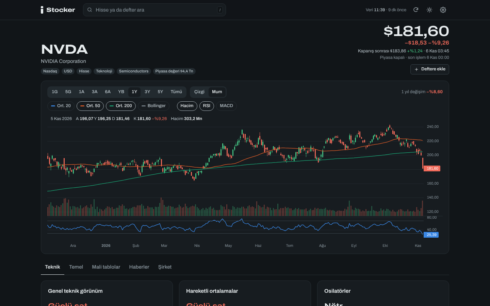

# Stocker

Portföy defterlerini izlemek için tarayıcıda çalışan bir uygulama: canlıya yakın fiyatlar, defter bazında kâr/zarar ve karşılaştırmalı getiri, hisse detayında teknik ve temel analiz, grafikler. Portföy verisi sunucuda değil, yalnızca senin tarayıcında durur; cihazlar arasında JSON dosyasıyla ya da taşıma bağlantısıyla aktarılır.

**Canlı:** https://erenciracioglu-dotcom.github.io/stocker/



## Neler var

- **Genel bakış:** tüm defterlerin TL ya da USD karşılığı toplamı, günlük ve toplam kâr/zarar, toplam kâr/zararın günlük seyri, BIST ve ABD seans durumu, son seansın en çok hareket eden hisseleri, yaklaşan bilanço ve temettü tarihleri ile kendi eklediğin olaylar (ör. FDA kararı).
- **Defter sayfası:** değer, maliyet, kâr/zarar, nakit; başlangıçtan bu yana getirinin S&P 500, Nasdaq, XBI, BIST 100, dolar/TL ya da gram altınla karşılaştırması; sıralanabilir pozisyon tablosu (seans dışı fiyatlar dahil); ağırlık ve sektör dağılımı.
- **Hisse sayfası:** çizgi ve mum grafik (1 günden 10 yıla), 20/50/200 günlük ortalamalar, Bollinger, hacim, RSI, MACD; teknik özet (ortalama ve osilatörlerin al/sat/nötr okuması), getiri ve risk (oynaklık, en büyük düşüş, beta, ATR), 52 haftalık aralık ve pivot seviyeleri; değerleme, kârlılık, bilanço, nakit yetme süresi, açığa satış, analist hedefleri ve not değişiklikleri; yıllık/çeyreklik mali tablolar, hisse sayısı (sulandırma), hisse başına kâr beklentisi; haberler ve şirket profili. Her göstergenin yanında ne anlama geldiği günlük dille yazar.
- **Taşıma:** dışa aktarılan dosya önceki Stocker ile aynı biçimdedir (`stocker.portfolios`, şema 1). İçe aktarırken aynı defterin daha yeni sürümü eskisinin yerini alır. Ayrıca tüm defterleri tek bir bağlantıya sıkıştırıp telefona gönderebilirsin.
- İlk açılışta, hiç defteri olmayan tarayıcıda THYAO, ASELS ve ALARK'tan kurulu bir **örnek defter** görünür. Dışa aktarmaya ve taşıma bağlantısına girmez, gerçek defter varken toplamlara katılmaz, ilk içe aktarmada kendiliğinden kalkar; Ayarlar'dan kaldırılıp yeniden eklenebilir.
- Açık ve koyu tema, telefonda ana ekrana eklenebilir.

## Veri nasıl geliyor

Tarayıcıdan Yahoo Finance'e doğrudan erişim (CORS) kapalı olduğu için geçmişi ve temel verileri GitHub Actions toplar, anlık fiyatları da küçük bir aracı getirir.

1. `.github/workflows/veri.yml` hafta içi borsa saatlerinde yarım saatte bir, ayrıca her push'ta çalışır.
2. `scripts/fetch_data.py` (yfinance) `tickers.json`daki semboller için fiyatı, 10 yıllık günlük geçmişi, son 5 günün 15 dakikalık mumlarını ve temel verileri çeker.
3. Sonuç `data` dalına kaydedilir (bir sonraki çalıştırma kaldığı yerden devam eder) ve siteyle birlikte Pages'e yayınlanır. Uygulama veriyi aynı adresten (`data/market.json`, `data/history/…`, `data/fund/…`) okur.

Elle çalıştırmak için: **Actions › Veri ve yayın › Run workflow** (her şeyi baştan çekmek için "full" kutusunu işaretle).

### Anlık fiyatlar

Sayfa açılınca ve üst çubuktaki yenile tuşuna basılınca fiyatlar `worker/` klasöründeki Cloudflare Worker'dan (`https://stocker-fiyat.fragrush-rooms.workers.dev`) anlık alınır: defterlerdeki hisseler, karşılaştırma endeksleri, kurlar ve açık hisse sayfası. Worker yalnız Stocker'ın adresinden gelen isteklere cevap verir; Yahoo Finance'in grafik uç noktasından son fiyatı, önceki kapanışı, gün içi mumları ve seans dışı fiyatı okuyup döner, hiçbir şey saklamaz. Aracıya ulaşılamazsa uygulama kayıtlı veriyle çalışır ve üst çubukta verinin saatini gösterir. BIST fiyatları Yahoo'da 15 dakika gecikmelidir.

Worker'ı yeniden yayınlamak için `worker/` içinde `npm install` ve `npx wrangler deploy` (Cloudflare girişi gerekir).

### Yeni hisse eklemek

`tickers.json`daki `portfolio` listesine Yahoo kodunu ekle (BIST hisseleri `.IS` ile biter, ör. `THYAO.IS`). Bir sonraki çalıştırmada verisi gelir. Uygulamada **Ayarlar › Piyasa verisi** bölümü eksik sembolleri gösterir; isteğe bağlı olarak yalnız bu repoya "Contents: Read and write" izni olan ince ayarlı bir GitHub anahtarı girersen eksikleri tek dokunuşla ekler.

`tickers.json` herkese açıktır; yalnız sembolleri içerir, lot ve maliyet bilgisi içermez.

## Dosya biçimi

```json
{
  "format": "stocker.portfolios",
  "schemaVersion": 1,
  "exportedAt": "2026-11-06T09:00:00.000Z",
  "portfolios": [
    {
      "id": "…", "title": "Biyotek Katalizör Sepeti", "kicker": "Yeni USD defteri", "description": "…",
      "capital": 5937.97, "cash": 0, "currency": "USD", "locale": "en-US", "entryDate": "2026-11-03",
      "accent": "#4f5bd5", "revision": 15, "updatedAt": "…",
      "positions": [
        { "ticker": "PYPD", "symbol": "PYPD", "name": "PolyPid", "sector": "Cerrahi enfeksiyon",
          "lots": 179.86, "entryPrice": 5.56, "priceSource": "manual" }
      ]
    }
  ]
}
```

`capital` = Σ(lot × giriş fiyatı) + nakit. Pozisyonlarda isteğe bağlı `entryDate` (sonradan eklenen hisse), `note` ve `events` (`[{ "date": "2026-12-15", "label": "PDUFA" }]`) alanları da tutulur; bilinmeyen alanlar içe/dışa aktarmada korunur.

## Yerelde çalıştırma

`baslat.bat` küçük bir yerel sunucu açar ve tarayıcıyı başlatır. Yerel klasörde `data/` yoksa uygulama veriyi Pages'teki canlı kopyadan okur. Veriyi yerelde üretmek için:

```
pip install -r scripts/requirements.txt
python scripts/fetch_data.py --out data
```

## Lisanslar

- Ziyaret sayacı: [GoatCounter](https://www.goatcounter.com/) (çerezsiz). Adresin `#` kısmı gönderilmez, sayfa başlığı sabit "Stocker" gider; defter verisi ve adları sayaca ulaşmaz.
- Grafikler: [TradingView Lightweight Charts™](https://www.tradingview.com/lightweight-charts/) (Apache 2.0), `vendor/` altında.
- Yazı tipi: Archivo (SIL Open Font License), `assets/fonts/` altında.
- Veriler Yahoo Finance'ten yfinance ile alınır; gecikmeli ve hatalı olabilir. Yatırım tavsiyesi değildir.
